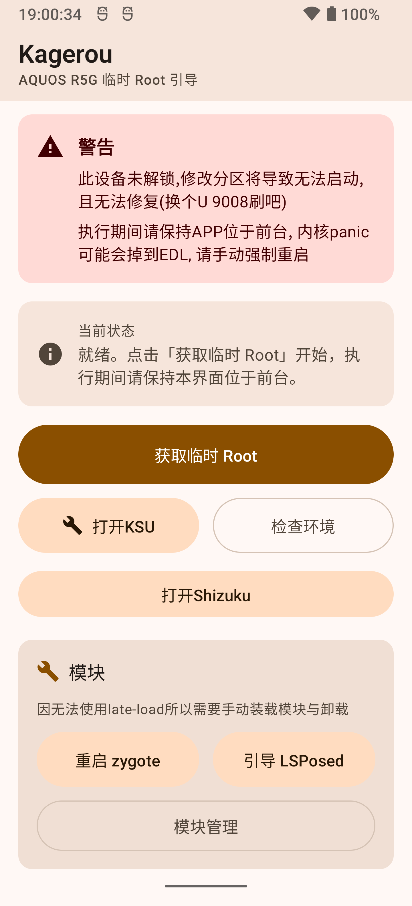
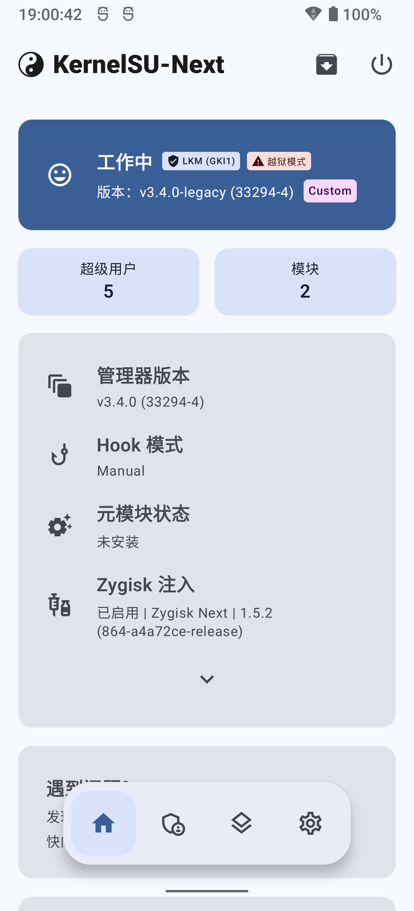

# Kagerou — 908SH 临时 Root

在 **Sharp AQUOS R5G (908SH)** 上通过内核漏洞拿到**纯内存态**的临时 root，并把
KernelSU-Next 作为 LKM 加载进去——**不解锁 bootloader、不刷 boot、不写任何分区**，
重启即消失。

- 设备：AQUOS R5G 908SH，Android 12 (API 31)，构建 S2011
- 内核：`4.19.125-perf`（arm64）
- 漏洞：CVE-2026-43499，futex PI 的 use-after-free（GhostLock）
- KernelSU：KernelSU-Next `v3.4.0-legacy`，LKM + 越狱（late-load）模式

> ⚠️ 仅供自有设备的安全研究与学习使用。此机型**没有可用的 EDL 救砖手段**，
> 分区损坏只能换U9008刷写,风险自负。
 
# 主页面截图


# KernelSU截图




## 现状

已在本机实测通过：

| 能力 | 状态 |
|---|---|
| 一键临时 root（Shizuku → shell → 漏洞） | ✅ 约 30 s |
| KernelSU 管理器/app 授权 | ✅ |
| 模块安装、`modules_update` → `modules` 合并、卸载 | ✅ |
| ZygiskNext 1.5.2 + LSPosed 2.0.1（热重启后激活） | ✅ |

## 工作原理

1. **漏洞**（`poc/`）：`pselect6` 把 `fd_set` 拷贝到内核栈，与 futex PI 的
   `rt_mutex_waiter` 复用同一块内存；PI 链重平衡时把受控值写到任意内核地址。
   本机型用它做两件事：把 `current->cred` 改成 `init_cred`（root），以及把
   `selinux_state.enforcing` 字节写成 0（permissive）。
2. **加载模块**（`app/assets/ksu_load.sh`）：以 root 身份 `insmod kernelsu.ko`。
   KernelSU 检测到不是 pid 1，走 **late-load** 分支：只给 insmod 进程 root，
   跳过 init.rc，所以用户态要自己补。
3. **补用户态**：`ksud install` 建 `/data/adb/ksud`（内核把 `/system/bin/su`
   重定向到它）、打上 `u:object_r:ksu_file:s0` 标签，然后 `ksu_enforce.sh`
   用 magiskpolicy 注入 `ksu` 域并恢复 enforcing。
4. **模块 / Zygisk**（`app/assets/ksu_modules.sh`）：
   - `merge`：把 `modules_update/<id>` 合并进 `modules/`（本来由 post-fs-data 做）；
   - `lsposed`：起 `zygiskd`、用 zygote 的 `BOOTCLASSPATH` 在 init 的 mount
     namespace 里拉起 `lspd`，再 `kill -9 zygote64` 让框架带着 Zygisk 重建。

## 仓库结构

```
app/       Kagerou Android 应用
  app/src/main/java/r5gk/boot/   漏洞编排、Shizuku、root 通道、模块页
  app/src/main/assets/           运行期释放到设备上的文件
  
poc/       GhostLock 移植到 aquos_r5g 的 PoC
  src/core/                      漏洞主体：slide/fops/pipe_physrw/root/…
  src/devices/aquos_r5g/         本机 offsets 与 target.h
  
kernel/    KernelSU-Next v3.4.0-legacy 的 4.19 适配（源码树）
  r5g-4.19.patch                 相对上游的全部改动
  build_wsl.sh                   在WSL里使用R5G官方内核树编译 .ko
  patch_ko.py                    把模块的未导出符号改写成 SHN_ABS 绝对地址
  gen_app_syms.py                生成 app 用的 name→offset 表
  ksu-syms.txt                   本机内核符号表（供上面两个脚本用）
```

`app/app/src/main/assets/` 里的运行期文件：

| 文件                                                  | 来源                                                         |
|-----------------------------------------------------|------------------------------------------------------------|
| `r5g.bin`                                           | 由 `poc/` 编译（`make` → `ghostlock`）                          |
| `kernelsu.ko`                                       | 由 `kernel/` 编译，地址在设备上用 kbase 计算                            |
| `ksu_syms.tsv`                                      | `kernel/gen_app_syms.py` 生成                                |
| `ksud`                                              | KernelSU-Next v3.4.0 管理器 APK 内的 `lib/arm64-v8a/libksud.so` |
| `manager.apk`                                       | KernelSU-Next v3.4.0 官方管理器                                 |
| `magiskpolicy`                                      | Magisk                                                     |
| `ksu_enforce.sh` / `ksu_load.sh` / `ksu_modules.sh` | 本项目                                                        |

## 编译

### PoC

```sh
export ANDROID_NDK_HOME=/path/to/ndk
cd poc && make            # 产物 ghostlock
cp ghostlock ../app/app/src/main/assets/r5g.bin
```

### 内核模块

需要一份能编译的 R5G 4.19 内核源码树(http://k-tai.sharp.co.jp/support/developers/oss/aquos-r5g/)

```sh
# 上游源码 + 本地改动
git clone -b v3.4.0-legacy https://github.com/KernelSU-Next/KernelSU-Next.git ksun
cd ksun && git apply /path/to/kernel/r5g-4.19.patch

# WSL 里对着内核树编译（改 build_wsl.sh 顶部的 SRC/OUT）
SRC=/path/to/msm-4.19 ./build_wsl.sh
# 生成 app 的 ksu_syms.tsv（走 stdout，重定向到 asset）
python3 gen_app_syms.py kernel/kernelsu.ko ksu-syms.txt \
        > ../app/app/src/main/assets/ksu_syms.tsv
```

### App

```sh
cd app && ./gradlew :app:assembleRelease
# 产物 app/build/outputs/apk/release/app-release.apk
```

依赖：JDK 17+、Android SDK 36、Compose BOM；`libsu` 从 JitPack 拉取。

## 使用

1. 安装 APK；启动 Shizuku 授权本应用。
2. 点「获取临时 Root」，约 30 秒完成；日志会显示 `insmod rc=0`、
   `ksud present`、`SELinux Enforcing`
3. 需要 Zygisk 模块时：在 KernelSU 管理器里装模块 → 回 app 点
   「引导 LSPosed」（会合并模块、起 zygiskd/lspd、热重启 zygote）
4. 模块页可下拉刷新，长按图标看说明；「更新」= 把暂存的模块合并进 `modules/`

## 已知限制

- **每个启动周期只能执行一次漏洞**；多次执行可能让设备内核 panic
- `ksud late-load` / `ksud soft-reboot` 在本机不可用（printk 死锁 / stop-start 卡死）
- 模块的 `system/` overlay 不会自动挂载（没有 metamodule）

## 许可

[GNU General Public License v3.0](LICENSE.txt)。

## 致谢

- [GhostLock](https://github.com/XiaoBaiLovesStirring/ghostlock-k419-adapter)：futex PI UAF 的原始 PoC 与多机型框架（本仓库的 `poc/` 是它的 `aquos_r5g` 移植）。
- [KernelSU-Next](https://github.com/KernelSU-Next/KernelSU-Next)：GPL-3.0，`kernel/` 是其 v3.4.0-legacy 的 4.19 适配，`manager.apk`/`ksud` 为其官方产物。
- [Magisk](https://github.com/topjohnwu/Magisk)：`magiskpolicy`（GPL-3.0）。
- [Shizuku](https://github.com/RikkaApps/Shizuku)：借 shell 权限执行漏洞。

